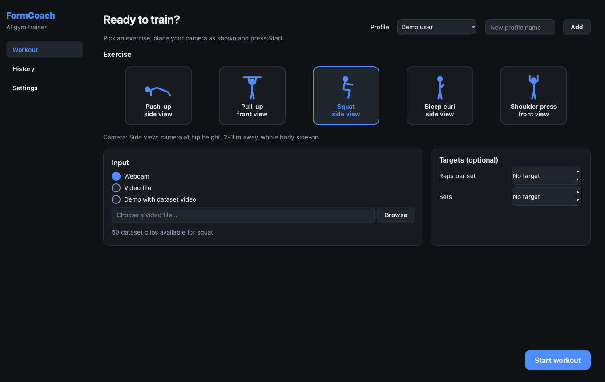
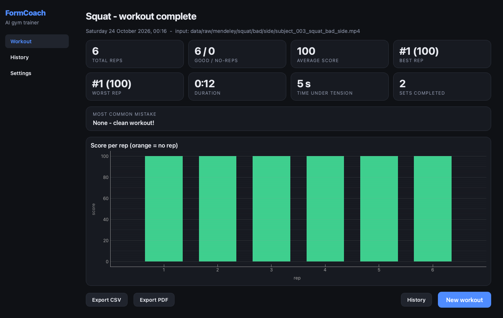
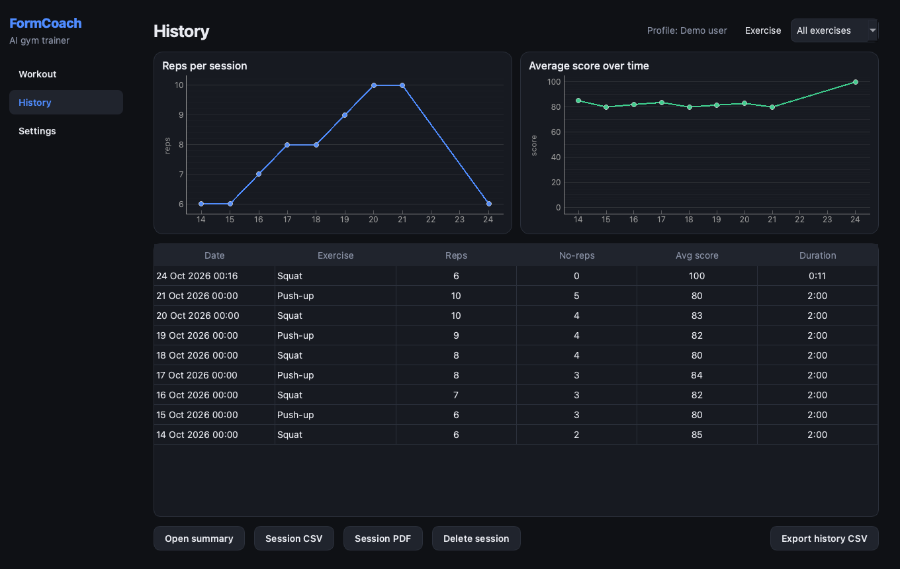
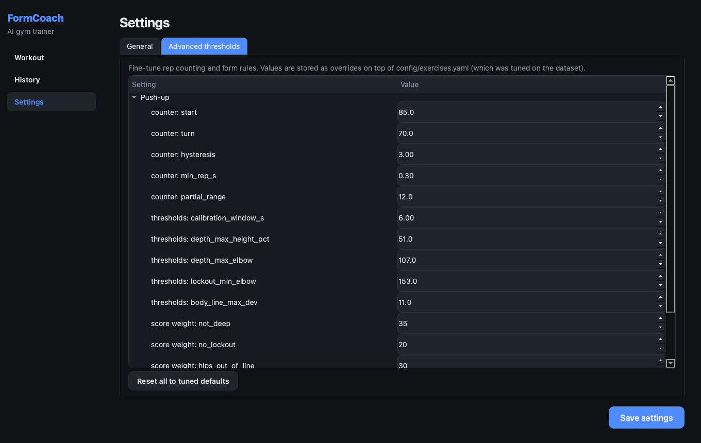
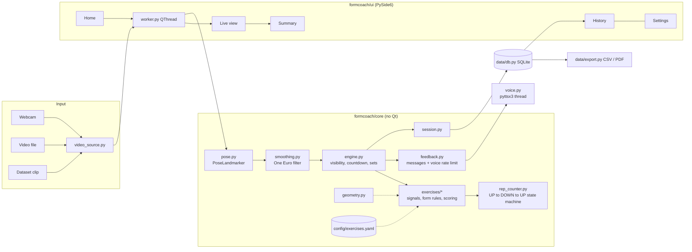

# FormCoach: AI Gym Trainer

**A desktop personal trainer that watches you exercise through a webcam, counts every rep, checks your form in real time, talks you through your set and tracks your progress - fully offline.**


## Features

- **Automatic rep counting** for 5 exercises - push-up, pull-up, squat, bicep curl, shoulder press - with a
  noise-proof state machine (hysteresis + minimum rep time), so jitter never counts as a rep.
- **Real-time form checking**: hips in line, depth, lockout, torso lean, knees past toes, elbow drift, body
  swing, kipping, left/right symmetry. The skeleton turns **red at the joints that break a rule**.
- **Score for every rep** (100 minus weighted faults). Reps with major faults are shown as an orange **"NO REP"**
  but are still recorded.
- **Offline voice coach** (pyttsx3 in its own thread), rate-limited so the same cue is never repeated within 4 s.
- **Robust to real life**: "Move so your full body is visible" / "Turn sideways to the camera" prompts when
  joints are hidden, a 3-second "get into position" countdown, and clean handling of camera disconnects, missing
  cameras and switching between webcam and video files.
- **Targets**: optional reps-per-set and number of sets, with set tracking and a "Next set" button.
- **Session summary**: total, good vs no-reps, average/best/worst rep, duration, time under tension, most common
  mistake and a rep-score bar chart.
- **History** per user profile with exercise filter and progress charts; **CSV export** (session or full history)
  and a **one-page PDF** session report.
- **Settings**: camera index, resolution, voice on/off and speed, dark/light theme and advanced threshold editing.
- **Demo with dataset video**: run the app on a clip from the downloaded dataset - no need to exercise in front
  of the camera.
- **All thresholds and score weights live in [`config/exercises.yaml`](config/exercises.yaml)** and were tuned on
  a public dataset (see [Evaluation](#evaluation)).

## Demo

| Home | Live workout |
|---|---|
|  | _Live view GIF placeholder - run `python -m formcoach.app --demo push_up` to see the skeleton overlay, rep counter and feedback (not committed because dataset clips show real people)._ |

| Session summary | History | Settings |
|---|---|---|
|  |  |  |

_The history screenshot uses sample sessions._

## Tech stack

| Area | Library |
|---|---|
| Pose estimation | MediaPipe Tasks `PoseLandmarker` (`pose_landmarker_full`) |
| Video / drawing | OpenCV |
| Desktop UI | PySide6 (Qt 6), pyqtgraph charts |
| Voice | pyttsx3 (offline TTS) in a background thread |
| Storage | SQLite (`sqlite3`) |
| Reports | reportlab (PDF), csv |
| Analysis / tuning | NumPy, SciPy (`find_peaks`, Savitzky-Golay) |
| Tests / CI / packaging | pytest, GitHub Actions, PyInstaller |

## Architecture

The engine (`formcoach/core`) has **no Qt imports** (enforced by a test), so it can be reused in a web or mobile
version. The UI runs pose inference in a `QThread` and talks to it only through signals.



## Installation

Requires Python 3.11+ (developed on 3.12, macOS arm64; CI runs on Ubuntu).

```bash
git clone https://github.com/Joshus7/formcoach-ai-gym-trainer.git
cd formcoach-ai-gym-trainer
python3.12 -m venv .venv
source .venv/bin/activate            # Windows: .venv\Scripts\activate
pip install -r requirements.txt
python scripts/download_models.py    # pose_landmarker_full.task -> models/ (9 MB)
python scripts/download_data.py      # dataset clips -> data/raw/ (~650 MB, re-runnable)
```

`download_data.py` gets the Mendeley videos through the public Mendeley API (no account needed). Pull-up clips come
from Kaggle and need an API token: create one at <https://www.kaggle.com/settings> ("Create New Token"), then
`mkdir -p ~/.kaggle && mv ~/Downloads/kaggle.json ~/.kaggle/ && chmod 600 ~/.kaggle/kaggle.json` and run
`python scripts/download_data.py --only kaggle`.

## How to run

```bash
python -m formcoach.app                        # the app (webcam by default)
python -m formcoach.app --demo push_up         # demo with a dataset video (push_up, squat, bicep_curl, shoulder_press)
python -m formcoach.app --video my_clip.mp4 --exercise squat
```

In the app: choose a profile and an exercise (the tile shows the camera angle to use), pick **Webcam**, **Video
file** or **Demo with dataset video**, optionally set target reps/sets and press **Start workout**.

Command-line tools (no GUI):

```bash
python tools/preview.py --dataset squat        # skeleton overlay + FPS on a dataset clip (or --webcam 0)
python tools/run_clip.py --exercise push_up data/raw/mendeley/push_up/bad/side/subject_002_push_up_bad_side.mp4
python -m pytest -q                            # tests
```

Build a standalone app: `./build.sh` (macOS/Linux) or `build.bat` (Windows) -> `dist/FormCoach`.

## How to train / tune

FormCoach doesn't train a neural network: it uses the pretrained PoseLandmarker plus geometric rules. The
*rules* are tuned on data:

```bash
python tools/extract_landmarks.py      # run PoseLandmarker over all clips -> data/landmarks/*.npz (cached)
python tools/reference_counts.py       # expected rep counts per clip via scipy.signal.find_peaks
python tools/tune_thresholds.py        # tune config/exercises.yaml on train subjects -> reports/tuning.md
python tools/evaluate.py --markdown reports/evaluation.md   # full-engine accuracy per exercise
python tools/make_fixtures.py          # refresh the small landmark fixtures used by the tests
```

`tune_thresholds.py` derives counting thresholds from the good-form clips and picks each form threshold so that
>= 85 % of good-form reps pass while flagging as many bad-form reps as possible. It tunes on subjects 1-17 and
reports results on held-out subjects 18-26.

## Evaluation

Full engine on the Mendeley clips (`reports/evaluation.md`, all subjects). *Rep-count accuracy* = 1 - total
absolute count error / total expected reps; *form accuracy* = good/bad clip classification (a clip is "bad" when at
least half its reps have a fault).

| exercise | clips | exact count | within +-1 | rep-count accuracy | form accuracy |
|---|---|---|---|---|---|
| Push-up | 48 | 38 | 45 | 97.6 % | 67 % |
| Squat | 50 | 39 | 46 | 92.5 % | 72 % |
| Bicep curl | 50 | 44 | 49 | 98.4 % | 68 % |
| Shoulder press | 50 | 39 | 44 | 93.9 % | 64 % |
| Pull-up | - | - | - | needs Kaggle clips | - |

On **held-out subjects only** (`reports/tuning.md`): push-up 95.5 % / 64 %, squat 96.9 % / 75 %, bicep curl
97.9 % / 75 %, shoulder press 93.4 % / 69 % (rep-count / form accuracy). The pose model runs at ~70 FPS on an
Apple-silicon laptop CPU (`tools/preview.py`).

## Project structure

```
formcoach/
  core/                 engine - no Qt imports
    pose.py             PoseLandmarker wrapper (pixel landmarks + visibility)
    smoothing.py        One Euro filter, rolling percentile
    geometry.py         angles, distances, line straightness, torso normalisation
    rep_counter.py      generic UP -> DOWN -> UP state machine
    exercises/          push_up, pull_up, squat, bicep_curl, shoulder_press (+ base.py)
    engine.py           visibility, countdown, sets, scoring per rep
    feedback.py         fault -> message, voice rate limit
    session.py          one workout and its statistics
    voice.py            pyttsx3 in a thread
    video_source.py     webcam / file / dataset clip
    overlay.py          skeleton drawing
  data/db.py            SQLite schema and access
  data/export.py        CSV + PDF
  ui/                   main_window, home_view, live_view, summary_view, history_view, settings_view, worker
  app.py                entry point
config/exercises.yaml   all thresholds and score weights
scripts/                download_data.py, download_models.py
tools/                  preview, extract_landmarks, reference_counts, tune_thresholds, evaluate, make_fixtures, run_clip
tests/                  pytest suite + fixtures/ (landmark JSON cut from the dataset)
reports/                tuning.md, evaluation.md
```

User data (database, settings, exports) is stored outside the repository in the app data folder
(`~/Library/Application Support/FormCoach` on macOS, `%APPDATA%\FormCoach` on Windows,
`~/.local/share/formcoach` on Linux). Override it with `FORMCOACH_HOME`. No images or video are ever saved.

## Datasets and credits

The data is used for **educational purposes** only. Nothing from the datasets is committed except small
landmark-coordinate fixtures (no images) in `tests/fixtures`.

| Dataset | Used for | Link | Licence |
|---|---|---|---|
| *A Multi-View Raw Video Dataset of Seven Fitness Exercises with Good/Bad Form Labels* - Sai Prashanth Duddela, Kamath Priya, Bhandary Rakshith, Pai S Ashlesh, PN Pratham, P Advith, Mashetty Abhishek (Mendeley Data, V2, doi:10.17632/kgbb3yn47p.2) | push-up, squat, bicep curl, shoulder press tuning, tests and demo | <https://data.mendeley.com/datasets/kgbb3yn47p/2> | CC BY 4.0 |
| *Workout/Exercises Video* (`hasyimabdillah/workoutfitness-video`) | pull-up clips (optional, needs Kaggle token) | <https://www.kaggle.com/datasets/hasyimabdillah/workoutfitness-video> | see the Kaggle page |
| MediaPipe Pose Landmarker (full) | pose model | <https://ai.google.dev/edge/mediapipe/solutions/vision/pose_landmarker> | Apache 2.0 |

## Limitations

- 2-D pose from one camera: angles depend on the camera angle, so stick to the recommended view for each exercise.
  Side-view elbow angles are noisy, which is why push-ups are counted from shoulder height instead.
- Form accuracy (64-75 % on held-out subjects) is clearly below rep-count accuracy. The dataset labels whole clips,
  not individual reps or fault types, so the rules can only be tuned coarsely. Squat form checks miss many of the
  dataset's "bad" squats.
- Pull-up thresholds are hand-set defaults with synthetic tests until the Kaggle clips are downloaded and tuned.
- One person in frame: MediaPipe tracks a single (the most confident) person.
- Expected rep counts come from an automatic peak detector, not human annotation.
- Chart colours change theme after a restart.

## Future work

- Per-rep fault labels (annotate a subset) to tune each rule individually; a small learned classifier on landmark
  sequences for good/bad form.
- Automatic exercise recognition, multi-person tracking, more exercises (lunges, deadlifts, planks with hold time).
- Front + side dual-camera mode; 3-D world landmarks for camera-independent angles.
- Web (WebAssembly MediaPipe) and mobile versions reusing `formcoach/core`.
- Workout plans and progressive-overload suggestions from the history.

## License

[MIT](LICENSE)
